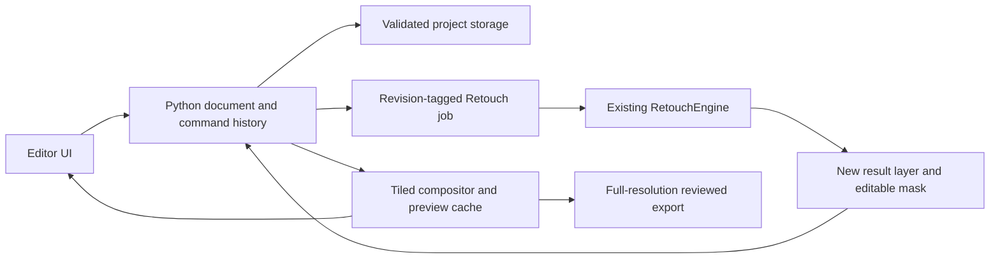

# Compositor-derived Python editor with Retouch

Date: 2026-10-07. Updated: 2026-10-12. Status: working Gradio layer editor; expanded finishing tools implemented, with explicit native sampling and packaging gates.

## Objective and scope

Build a local layer-based photo editor whose automatic portrait processing is
provided by the existing Retouch engine. Users can run a recipe into a new
layer, paint its mask, adjust opacity, make manual corrections, save a project,
and export the reviewed composite. Keep Retouch's CLI, batch, current desktop
launcher and video export usable throughout development.

The upstream source is pinned to `11d8d7a50992b24fd9a760a1c13b1c01b70aaf30`.
A durable source reference now lives in
`third_party/compositor/source-11d8d7a.tar.gz`, with its origin, SHA-256 and
MIT notice recorded in `third_party/compositor/PROVENANCE.md`. Temporary
checkouts are disposable; development no longer depends on the original
`/private/tmp` checkout or archive surviving. The archive is reference source,
not a Python runtime dependency.

Source: https://github.com/robbietilton/Compositor
License: MIT, copyright 2026 Wonder Assembly LLC. Preserve the upstream
copyright and complete license in all copied/translated substantial code and
distribution notices. Record the pinned origin for each ported module.

## What can be reused and what needs replacement

| Upstream area | Python implementation approach | Verification |
| --- | --- | --- |
| Document/LayerMask, LayerAdjustment, DocumentHistory | Explicit document/layer records; command-based undo; immutable source assets | Undo/redo, mask edits, transforms and dirty-state contracts |
| IO/ProjectStore, ProjectWatcher, external changes | Validated `.comp` reader/writer; atomic save; revision/digest tracking | Round trips, invalid paths/references, interruption and external-edit conflicts |
| Rendering/LayerRenderer, SeparableBlend, LiveMaskRenderer | NumPy/OpenCV tiled CPU reference renderer; explicit RGBA/alpha semantics | Transparent edges, blend modes, masks and golden composites |
| Rendering/BrushPixels.c, HealPixels.c, ContentFill.c | Inspect numerical kernels and port selectively; benchmark before replacing compiled kernels | Brush strokes, healing boundaries and captured real-photo output |
| SwiftUI/AppKit views and native dialogs | New UI; no mechanical Swift-to-Python conversion | Pointer/keyboard interaction, dialogs and accessible controls |
| Metal/Core Graphics/Core Image rendering | Backend abstraction; CPU baseline first, accelerated backend after parity | CPU/backend agreement and memory/runtime measurements |
| Apple-specific subject/object selection and RAW handling | Retouch's existing detection/parsing/input paths where suitable | Test model/format support; do not assume API equivalence |

Inspect upstream tests as behavioral references, especially ProjectTests,
LayerMaskTests, MaskTransformTests, AdjustmentLayerTests and BrushTests.
Translate relevant cases with attribution when copied. Running the upstream
Swift suite requires full Xcode; this machine currently has Command Line Tools
only. The installed Compositor app can still serve as a visual reference.

## Proposed architecture



Keep document and renderer modules independent of UI bindings. Proposed package:
`retouch/editor/{document,commands,project_store,composite,retouch_jobs}.py`.
Do not introduce a second retouch implementation or map its recipe sliders to
approximate compositor adjustments. Retouch produces actual processed pixels;
the editor controls their composition.

A Python desktop UI can use PySide6 (official Qt Python bindings), subject to
an isolated dependency/packaging and license review. It is a proposal, not an
installed dependency. Current Retouch supports Python 3.9+ and its desktop uses
pywebview/Gradio; adding Qt must not force a runtime upgrade or replace that
launcher without compatibility evidence. A web canvas in the existing shell is
an alternative if Qt cannot fit the supported runtime. Choose after the small
UI dependency spike, before implementing the full editor.

Python owns orchestration and numerical array operations. Performance-critical
work should use compiled NumPy/OpenCV operations, not Python pixel loops.
GPU parity and performance are separate milestones; Swift/Metal speed is not
automatically preserved by a Python translation.

## Milestones and completion gates

1. **Freeze the reference and establish a format/renderer harness.** Retain the
   pinned source snapshot and MIT notice, inspect relevant upstream tests,
   create small RGBA/mask fixtures and real-photo reference composites. Reconcile
   source and published format documentation; the checked-out DocumentLimits
   already differs from older documented fixed pixel budgets. Select the UI
   runtime in an isolated environment. Complete when fixtures and provenance
   are reproducible without changing the current Retouch environment.
2. **Python document core and basic composition.** Layers, order, visibility,
   opacity, Normal alpha composition, raster masks, save/open and flattened
   PNG export. Read only a declared `.comp` subset initially; reject unsupported
   semantics explicitly rather than silently flattening or losing them. Complete
   when save/load and reference compositions agree, with bounded memory and
   failure-safe saves.
3. **Runnable editor MVP.** Zoom/pan, layer panel, reorder, mask brush/erase,
   undo/redo and unsaved-change prompts. Initially bound preview resolution,
   retain native source pixels and tile exports. Complete when a user can open
   a photo, edit a mask, undo, save, reopen and export without losing edits.
4. **Retouch-powered layers.** Recipe/strength controls create a new result layer
   from a captured input/settings/document revision. Run the engine in a worker
   process; cancel cooperatively, reject stale results and reuse its model/cache
   conventions. A layer result remains baked pixels; changing its recipe reruns
   Retouch and creates a new revision. Complete when a real-photo recipe render
   is editable and the fully revealed layer reproduces the engine output.
5. **Expanded finishing tools.** Prioritize Multiply/Screen/Overlay/Difference,
   transforms, selections, clipping/group masks and grading adjustments by
   actual workflow needs. Healing/cloning follow with their own visual tests.
   Never claim all upstream modes/features are supported after the MVP.
6. **Production scale and packaging.** Dirty-tile caching, history budgets,
   crash recovery, color-managed export, representative native-resolution photo
   profiling, optional acceleration and platform packaging. Validate each OS
   actually supported before calling the editor cross-platform.

### Progress

- 2026-10-11, milestone 6 crash recovery: the Layer Editor autosaves unsaved
  work. After any edit that leaves the document dirty, `retouch/editor/recovery.py`
  writes the current revision in a background thread as an ordinary `.comp`
  package plus a small JSON description in the per-user recovery folder
  (`~/Library/Application Support/ProMaxRetouch/Recovery`,
  `%LOCALAPPDATA%\ProMaxRetouch\Recovery`, `$XDG_DATA_HOME/promaxretouch/recovery`;
  `RETOUCH_EDITOR_RECOVERY_DIR` overrides). The newest pending revision wins,
  writes reuse the staged swap-in so an entry is never half written, and a
  failed write is logged without interrupting editing. Saving, undoing back to
  the saved revision, or opening another document with "discard" deletes the
  entry; a crash, force quit or closed window keeps it. "Recover unsaved work"
  (opened automatically when the tab is selected and entries exist) lists
  entries with name, size, layer count and time; Restore opens one as unsaved
  work and keeps replacing the same entry, Discard deletes it. Entries a live
  session owns are not offered to another window. Entries older than 30 days,
  descriptions without a package and staging folders of interrupted writes are
  cleaned when the list is read. Measured in the cloud sandbox on a 4160 ×
  6240 photo with two full-size layers: the edit returns in 1 ms, the first
  autosave takes 2.4 s in the background, later ones 0.03-0.1 s; restore
  4.7 s, composite exact. In the running GUI, a photo opened and renamed,
  the server killed with SIGKILL and restarted: the entry was offered and
  restored with the edit. Focused tests: `tests/test_editor_recovery.py`
  (including a subprocess that exits without cleanup). Not checked on a Mac
  or Windows disk, nor in the packaged desktop window.
- 2026-10-10, milestone 6 fast saves: saving no longer re-encodes layer
  pixels or masks that are unchanged since they were opened or last saved.
  Layer arrays are immutable, so `project_store` remembers which PNG holds
  each array's bytes (weakly, checked against the file's inode, size and
  modification time) and copies that file into the new package; any changed,
  new or externally modified asset is encoded, several in parallel, at zlib
  level 1 (`ASSET_COMPRESS_LEVEL`) instead of Pillow's default 6. A failed
  copy falls back to encoding; the staged swap-in is unchanged. Flattened PNG
  exports keep the default compression. Measured in the cloud sandbox (4
  cores) on a 4160 × 6240 photo with a second full-size layer and a mask:
  first save 17.7 s -> 2.2 s, re-save after an opacity change or mask stroke
  0.2 s (was a full re-encode), save right after opening 0.04 s; the package
  is about 20% larger (62 vs 52 MB). Reopened composites were exact. Focused
  tests: `tests/test_editor_project_store.py::TestFastSave`. Not measured on a
  Mac or Windows disk.

- 2026-10-09, milestone 5 fit to canvas: Fit layer to canvas scales the current
  rendered proportions to fit completely inside the canvas and centers the layer.
  Whole-pixel rounding uses a one-pixel minimum; odd spare pixels go to the
  right/bottom. Size and position change as one undo step. Native source pixels,
  masks, flips, sampling, visibility and opacity are retained. Pending brush
  strokes and total rendered-surface budget violations block the action.
  Already-fitted layers are a no-op that preserves saved state and redo history.
  Verification: 191 focused editor tests passed, including mask/flip alignment,
  undo/redo, save/reopen, centering, rounding and budget rollback. On the previous
  real-photo smoke render, a 360 × 480 source fitted to 375 × 500 at (212, 0)
  on an 800 × 500 canvas; source pixels stayed intact and save/reopen/undo/redo
  composites were exact. The output sheet was viewed; Safari verified the fit
  button, resulting size/position and real-photo composite preview. Native Compositor renderer
  parity and representative native-resolution performance remain open.
- 2026-10-09, milestone 5 proportional resizing: Keep aspect ratio is on by
  default. Resize from chooses Width or Height; the other dimension is derived
  from the current rendered rectangle, rounded half-up to whole pixels with
  a one-pixel minimum. Turn off the lock to set dimensions independently.
  Source pixels and masks, placement and flips are retained. Resize is one undo
  step; saved projects retain the calculated size. Invalid primary dimensions,
  oversized surfaces and unapplied strokes are rejected without losing edits.
  Verification: 182 focused editor tests passed and governance CI reported no
  errors or warnings. A 360 × 480 real-photo render resized to 180 × 240 without
  replacing source pixels; save/reopen and undo/redo were exact, and the output
  sheet was viewed. Safari verified width-based 180 × 240, height-based 90 × 120
  and undo back to 180 × 240. Native Compositor scaled-render parity remains open.
- 2026-10-09, milestone 5 mask reset: Reset mask removes stored coverage from
  the selected layer, revealing its pixels at the current opacity. Source
  alpha, visibility, placement, resizing and flips are kept. Removing a stored
  mask resets enablement to on, so subsequent painting works immediately and
  matches the `.comp` format's default for layers without a mask asset.
  Undo restores the exact previous mask; saving/reopening retains the reset.
  Pending strokes must be applied or erased first. Resetting a layer without
  a mask is a no-op that preserves redo history and saved-revision tracking.
  Verification: 167 focused editor tests passed; governance CI reported no
  errors or warnings. On the previous 360 × 480 real-photo smoke render,
  resetting a fully hidden result reproduced its unmasked pixels exactly;
  undo, redo and save/reopen were pixel-identical. The comparison was viewed.
  This slice uses callback tests and rendered photo checks; its new button
  has not received a separate browser interaction check or native-app parity.
- 2026-10-09, milestone 5 layer/mask finishing slice: Duplicate layer inserts
  a separately editable copy directly above the source and selects it. Pixels
  and masks share immutable buffers until edited; placement, size, flips,
  visibility, opacity, blend mode and mask enablement are retained. Invert mask
  swaps stored coverage (255 minus coverage) without resampling or changing
  source pixels; an absent mask becomes a compact fully hidden mask. Disabled
  masks stay disabled. Both actions are one undo step, round-trip through
  `.comp` saves, and require pending brush strokes to be applied or erased.
  Genuine-engine smoke check: a 360 × 480 top-middle portrait crop from
  `docs/reference_targets/chang_e_cosplay_tamed_shine.jpg`, `natural`, detected
  one face. Nose Tip Blush at 50/100 changed 350/471 pixels (maximum channel
  deltas 4/10); repeating 0 was pixel-identical. The face comparison at 0/50/100
  was viewed. A duplicated result layer with a gradient mask was inverted,
  saved/reopened and undone/redone with exact composite equality; the photo
  comparison was viewed. This is one small edited cosplay reference portrait,
  not a native-resolution or representative skin-tone qualification.
  Focused verification: 379 Nose Tip Blush/GUI/parameter tests and 161 editor
  tests passed; governance CI reported zero errors and warnings. Safari opened
  the real-photo project, selected the new duplicate and rendered mask inversion.
  Rotation, selections, clipping/group masks, grading adjustments and native
  Compositor parity remain separate milestones.
- 2026-10-08, milestone 5 resizing slice: layer width/height controls update the
  rendered rectangle without replacing source pixels. Undo and save/reopen
  retain both source and transform. RGBA interpolation preserves alpha edges,
  masks remain aligned under resizing and flips, and painting a scaled layer
  stores coverage at source resolution. Rendered surface budgets are enforced
  before decoding/allocating oversized transformed layers. Rotation remains
  unsupported; native Compositor scaled-render parity remains pending.
- 2026-10-08, milestone 5 placement slice: Position & flips controls set integer
  canvas X/Y placement and horizontal/vertical flips as one undoable edit.
  Negative placement clips at canvas boundaries; save/reopen retains placement
  and flips. The brush canvas shows the selected layer's flipped orientation;
  applied strokes map back to source mask coordinates so pixels and mask flip
  together exactly once. Pending strokes block transforms. Rotation remains
  unsupported. Focused tests cover clipped placement, saved transforms,
  failed-edit rollback and brush alignment under all flip combinations.
- 2026-10-08, milestone 5 blend slice: Multiply, Screen, Overlay and Difference
  render alongside Normal, with a Blend mode control in the layer panel.
  Property edits are undoable, and save/reopen retains the mode. Masks,
  opacity and partial backdrop alpha participate in the composition; hidden
  unsupported modes remain stored but cannot be revealed without choosing a
  supported mode. The handoff's Difference inspection layer is now usable.
  Formula/evidence boundaries are recorded in COMPOSITOR_FORMAT_NOTES.md.
- 2026-10-08, milestone 4 implementation: Layer Editor recipe controls capture
  the current native composite, recipe, strength, document ID and revision.
  `retouch/editor/retouch_jobs.py` runs the existing `RetouchEngine` in a
  separate Python process and publishes a new fully revealed mask/result
  layer through the serialized editor queue. Strength is result-layer opacity;
  the recipe's engine settings remain unchanged. Hiding the result restores
  the captured underlying composite, and adding it is undoable. Manual edits
  or unapplied strokes while rendering reject the result. Document replacement
  waits for the active render to end. Cancellation works independently of the
  render queue, checks publication boundaries, and terminates only this worker
  after a two-second grace period. Jobs time out at 15 minutes. Workspaces
  are cleaned after workers exit. Transparent composites are explicitly refused
  for this first slice to avoid compositing result alpha twice. Frozen builds
  require `RETOUCH_EDITOR_PYTHON`; ordinary runs use their existing Python.
  Focused tests include simulated-engine color/opacity contracts and actual
  subprocess completion/cancellation; those alone are not real-photo engine
  qualification or native-app visual parity.
  Local genuine-engine smoke evidence: `natural` on a 512-pixel copy of
  `docs/reference_targets/chang_e_cosplay_tamed_shine.jpg` (a photo contact
  sheet). Render completed; saved project's revealed composite equals the
  worker PNG exactly, and hiding the result restores captured input exactly.
  The input/output sheet was viewed. This is not native-resolution portrait
  qualification or evidence for every recipe.
- 2026-10-08, milestone 3 UI slice: the existing Gradio shell now includes
  a Layer Editor tab (`retouch/editor/ui.py`). Open a photo or local `.comp`
  folder; add/remove/reorder layers, set name/visibility/opacity, paint white
  (reveal) or black (hide) on the selected layer's local canvas, apply as one
  undo step, save a `.comp` folder and download a native-resolution PNG.
  Previews are capped at 1024 px; source pixels remain native, embedded ICC
  profiles convert to sRGB on import. Only painted support changes an existing
  mask. Opening a replacement requires explicit discard when edits or strokes
  are pending; saving/exporting blocks unapplied strokes. Browser unload
  prompts cover dirty projects and pending strokes. Editor callbacks serialize
  to avoid overlapping mutations. Workspaces are session-owned and cleaned
  when released. Recipe worker integration is recorded in the milestone 4 entry.
  Synthetic two-layer Safari review verified open, visibility, undo, save and
  PNG delivery; brush calculations/native preservation have regression tests.
  Real-photo brush interaction and native Compositor renderer parity remain
  separate acceptance checks.
- 2026-10-07, milestone 3 foundation: `retouch.editor.DocumentHistory` adds
  validated, transactional layer add/remove/reorder, property updates, masks
  and pixel replacement, with undo/redo and saved-revision dirty tracking.
  Use its `document` snapshot for rendering; edits go through history methods.
  New documents start dirty; opened projects use `saved=True`. Its `save(path)`
  marks clean only after success; undo to that revision is clean, while a
  new edit after undo discards redo without reusing revision IDs. Metadata is
  detached and immutable arrays are shared. Defaults: 100 undo entries,
  512 MiB of unique retained array buffers (including current document).
  Old history is pruned first; if current pixels alone exceed the budget,
  retain the document and drop undo history. This does not cap total RSS.
  Native-app parity remains pending; Advanced Retouch's existing history
  is a separate workflow. UI work is recorded in the following day's entry.
- 2026-10-07, milestones 1-2: done in the cloud, except the parts that need a
  Mac. `retouch/editor/` holds the document model, the validated `.comp`
  reader/writer for a declared subset and the Normal-blend reference
  compositor; `third_party/compositor/` the license and provenance;
  `scripts/dev/compositor_reference.py` the real-photo check. Details,
  docs-versus-source differences, the declared subset, colour rules, evidence
  and the UI spike: [COMPOSITOR_FORMAT_NOTES.md](COMPOSITOR_FORMAT_NOTES.md).
  Still open: parity against the Mac app's own export, and the UI runtime
  choice (recommended in the notes, not decided).

Video remains on Retouch's existing tracking/stabilization/export path. A
timeline editor and per-frame layer history are a separate project.

## Color, precision and editing safety

Define working-sRGB, straight versus premultiplied alpha, RGB/BGR boundaries,
blend gamma and rounding before porting blend functions. Upstream's
SeparableBlend explicitly uses sRGB for relevant modes; linear-space blending
can produce visibly different results. Float working buffers must not be
advertised as recovering precision from 8-bit `.comp` assets. Retouch's current
high-bit export routes remain separate until a color-managed editor path is
verified. Do not copy source content credentials onto changed pixels.

Live exchange must identify the document, writer and revision; external edits
need a conflict prompt and must preserve manual work. Reloading the native app
clears its undo history. Do not continually overwrite a user's working project.
The first bridge therefore produces a new handoff per export.

## Current implementation and acceptance evidence

### Colour brush on layer pixels — 2026-10-17

Open **Paint colour on a layer**. **New paint layer** adds an empty layer above
the selected one and loads it; **Load selected layer for painting** loads any
image layer. The canvas shows the visible image under the layer's rectangle in
its displayed orientation. Choose Paint or Erase, a colour, brush opacity and
edge softness, paint, then **Apply paint strokes**: one undo step
(`Paint on layer` / `Erase on layer`) that saves and reopens like any pixel edit.

`retouch/editor/layer_paint.py` ports the colour path of upstream
`Document/BrushStroke.swift`. Since the c4d785f native-oracle audit, each
canvas layer is one native stroke: `stroke_coverage` bakes the brush opacity
into each stroke's alpha and combines separate strokes by screen
accumulation — `1-(1-a1)(1-a2)` — so two 50% strokes stack toward 75%,
matching BrushStroke.swift's per-stroke fill composition. Within one canvas
layer the browser has already flattened overlapping dabs, so the cap still
holds there. Coverage is then recomposed as premultiplied
source-over of one sRGB colour, 8 bits per channel; Erase takes
`coverage x opacity` out of alpha (`destinationOut`) and leaves colour alone.
The current selection can clip strokes (mapped through the layer's placement,
scale, flips and rotation). Zero-coverage pixels stay bit-identical. Folders,
adjustment layers, text and shape layers are refused with a message.
Deliberate differences: the browser rasterises a hard round tip, so softness
blurs coverage instead of upstream's per-dab Gaussian falloff; paint stays
inside the layer's rectangle (upstream grows a painted layer to the canvas).

Tests: `tests/test_editor_layer_paint.py` (13), including a Porter-Duff
oracle (Pillow `alpha_composite`, within 2 levels), per-stroke screen
accumulation (two 50% canvas-layer strokes overlap at 75%,
`test_separate_canvas_layers_accumulate_like_native_strokes`) and the
single-canvas-layer opacity cap
(`test_opacity_caps_strokes_within_one_canvas_layer`),
native-grid mapping from a reduced preview, flips, placed selections, undo and
`.comp` round trip, and the UI callbacks. Browser check on DSCF3503 (headless
Chromium): new paint layer, colour change updates the brush live, a stroke
applied, then part of it erased; evidence in
`/mnt/project-files/retouch/layer-paint/`. Not compared with the Mac app.

### Texture-aware local healing — 2026-10-16

Local retouch → Heal → **Texture-aware** reuses Retouch's deterministic classical
PatchMatch primitive to fill small painted defects from nearby texture. **Nearby
pixels** uses eligible pixels outside the stroke; **Current selection** (the
default) restricts
donor patches to selected material within the search area. The donor selection
is separate from the optional destination-selection limit; leave the latter off
for donor-only selections. The 16–256 native-pixel search distance controls the
local context. Soft brush alpha is applied once after filling. The operation
creates a separate masked raster layer with existing opacity/save/undo support.

Search uses a fixed seed, 7-pixel patches, three passes and up to 64 random
candidates per destination. Repairs above 4,096 painted native pixels or 262,144
search pixels are rejected before composition/search. No donors, invalid options,
stale captures and no-change results leave history untouched. A donor region too
small for a full patch can use the existing donor-constrained Telea fallback;
the resulting layer name and status explicitly report that fallback. Source
layers and all pixels outside painted support remain exact. This is texture
filling, not semantic reconstruction of a hidden object. Good matching material
is still necessary: unrestricted search copied nearby costume trim into plain
fabric in the browser test. No seamless/lighting blend is applied: a real speck test
showed the existing optional seamless primitive could retain the defect.

Focused local/editor/clone/picker/recipe/worker and PatchMatch suites:
**179 passed** (194 including the healing suite). Real-photo testing repaired a labeled planted costume speck
using a selected fabric donor region; source preservation, outside support,
save/reopen and undo/redo were exact. The portrait and enlarged comparison with
Telea were inspected. The 49-pixel texture repair took about 0.032 s locally;
a separate synthetic 4,096-pixel repair with a 36,864-pixel search area took
1.57 s. A browser pointer-painted repair with a preloaded clean-fabric donor
selection created and saved a Texture-aware layer; independent reopening found
562 changed pixels, exact source preservation and exact output outside its
562-pixel stroke support. That output was also inspected. These are individual
local measurements, not runtime guarantees or
broad skin/fabric quality certification. Temporary evidence:
`/tmp/retouch-texture-heal/`.

Finalized in `c4d785f` (was WIP): the UI wires donor-area and search-distance
controls into `applying_local` (donor choice validated; **Current selection**
requires a live selection), the apply status names the created layer, and the
heal auto-radius for Telea/Navier-Strokes local strokes is clamped to 8 with
padding <= 64 — a 40x100 preview stroke previously padded to a ~470x710 inpaint
region at radius 42, costing 2.3 s in `cv2.inpaint` alone. The committed suite
adds the real donor-constrained search (source-map verified against the donor
mask), unmocked seed determinism, the donor-exhausted refusal, degenerate
fallback naming, and an 8-way invalid-input parametrize asserting history is
never touched (`tests/test_editor_texture_heal.py`, 6 tests / 13 cases, plus
the UI fallback-reporting callback test in `tests/test_editor_ui.py`).

### Colour range selection — 2026-10-21

Layer Editor → Selections gains **Create colour range selection** (port of
upstream `WandPixels.c color_range_mask`): include colours as
`[[R, G, B], ...]` text, optional exclude colours, and a 0-200 fuzziness
slider. A pixel matches when its straight RGB is within the fuzziness of any
include colour on **every** channel — a per-channel box distance, not a
vector norm and not hue/HSV (hue-equal darker pixels do not match) — and not
within range of any exclude colour. The mask is binary 0/255; fully
transparent pixels never match; an empty include list yields an empty mask
(native `hasColors` guard) rather than an error. Sampled over the visible
composite like the wand; combines Replace/Add/Subtract/Intersect with the
current selection, and an empty Replace deselects. Creating a selection never
edits pixels or history.

`retouch/editor/selections.py` `color_range_selection` validates the triplet
text (finite 0-255 values, `[[255, 0, 0]]`-shaped), the fuzziness (finite,
clamped 0-255) and the canvas budget. Tests:
`tests/test_editor_color_range_selection.py` (13) cover exact-match,
box-vs-norm and RGB-vs-HSV semantics, include union, exclude subtraction,
fuzziness boundaries, binary mask values, transparent pixels, empty include,
validation raises, combine modes, UI wiring and selection ephemerality.

### Copy/Cut selection as layer — 2026-10-21

Native Cmd-J / Cmd-X parity (upstream `SelectionClipboard.swift`):
**Copy selection as layer** takes the visible composite inside the selection's
whole-pixel bounds as a new raster layer above the active one (inside its
folder), named `Layer N` like upstream. Feathered edges become partial alpha
via a straight-alpha coverage multiply. **Cut selection as layer** is that
copy plus clearing the active layer's selected pixels — transparent holes,
never a content fill — and drops the layer's recipe source/settings since the
recipe no longer matches the edited pixels. Both are one undo step
(`Copy/Cut selection as layer`), clear the selection (upstream's
`addPixelLayer` drops it on paste), and select the new layer. Folders,
adjustment, text, shape and empty layers are refused for cut; an absent,
empty or wrong-shaped selection raises like crop-to-selection. Pixels outside
the selection and the other layers are untouched; adding the copy back over
the stack is a composite identity.

`retouch/editor/commands.py` `DocumentHistory.copy_selection_as_layer`.
Tests: `tests/test_editor_copy_selection.py` (11): bbox extraction and
composite identity, soft-selection alpha weights, cut holes vs fill, gates,
empty-selection raises, undo/redo of both layers, off-canvas clamp, blended
multi-layer identity, `.comp` save/load round trip, UI wiring (selection
dropped, labels) and UI refusals.

### Click-to-place clone anchors — 2026-10-16

After loading the local composite, choose Clone and **Load clone source picker**.
Click the source texture on the photo (green cross), then the destination (pink
cross). Source selection switches the picker to Destination automatically. The
two points set the existing native-pixel X/Y offsets; numeric refinement remains
available. Paint around the destination on the local retouch canvas and apply.
The markers are preview annotations and never enter saved or sampled pixels.
Changing either anchor recalculates the aligned offset. Reloading the picker
clears anchors and offsets; document edits invalidate its captured revision.
Anchor choices are temporary session controls, not saved project data.

`retouch/editor/clone_picker.py` maps preview pixel centers into native document
coordinates and retains a server-rendered preview. The picker never trusts
browser image pixels. Focused picker/local-retouch/UI/recipe/worker checks:
**159 passed**. Real-photo testing uses clicked anchors to repair a labeled
planted background speck; donor pixels, untouched source, outside-stroke pixels,
save/reopen and undo/redo remain exact. Full portrait and enlarged repair were
inspected. Browser pointer clicks selected Source `(185, 171)` and Destination
`(233, 219)`, producing offsets `(-48, -48)` and both markers. Temporary evidence:
`/tmp/retouch-clone-picker/`. This is manual aligned cloning; automatic donor
matching and a live moving donor overlay are outside this slice.

### Local clone tool — 2026-10-16

Local retouch now offers **Clone**. Load the composite, choose Clone, set the
source X/Y offset in native document pixels, paint the destination and apply.
Negative X samples left; negative Y samples above. The offset stays aligned
across the stroke. Sampling uses the visible composite at the captured revision,
including overlapping donor/destination areas. Zero, fractional, invalid or
out-of-canvas source offsets are refused without changing history. Sources must
exist for every painted destination remaining after the optional selection limit.

The result is a cropped masked layer with adjustable opacity and existing
save/reopen/undo support. Soft coverage is baked once. Pixels outside painted
support and original source layers remain exact. Initial source placement used
numeric offsets; the follow-up above adds click-to-set anchors on a preview.
This is direct pixel copying, so matching donor texture and lighting is manual.

Focused local-retouch, editor UI, recipe-layer and worker suites: **148 passed**.
Governance: **0 errors, 0 warnings**. Tests cover overlapping donors, soft alpha,
native coordinates from a reduced preview, selections and invalid sources. A
real portrait with a labeled planted background speck changed exactly 49 pixels;
donor pixels, outside support, source preservation, save/reopen and undo/redo
were exact. The full portrait and enlarged repair were inspected. Browser checks
loaded the composite, selected Clone, exposed its source controls, hid the
healing-method picker and accepted a negative X offset. Browser pointer painting
was not repeated for this slice; callback tests exercise apply/save/undo. Temporary
evidence: `/tmp/retouch-clone/`.

### Expanded editable recipe controls — 2026-10-16

The recipe section now includes independent overrides for Iris Pop, eye
catchlights, cheek blush, nose tip blush, face shadow fill and skin detail
retention (`texture_opacity`, 0–1). Disabled controls defer to the chosen recipe;
enabled zero values explicitly disable that effect. Smoothing/whitening retain
their existing shared override switch. Engine ParamSpec ranges and defaults
drive the new controls and saved-setting validation. Loading a saved recipe
restores both values and enabled states, including slider interactivity.
Existing smoothing/whitening-only projects still load.

Focused editor UI, recipe-layer and worker checks: **115 passed**; governance:
**0 errors, 0 warnings**. A real portrait rendered with all six new overrides,
saved/reopened and regenerated the same layer: 11,286 pixels differed from
the recipe-only render; original source, save/reopen composite and undo were
exact. Both rendered images were inspected. This verifies this portrait and
settings path, rather than broad photographic quality. Browser verification
restored all six saved values and override switches, and disabling Iris Pop
disabled only its own slider. Temporary evidence:
`/tmp/retouch-expanded-controls/`.

### Re-editable recipe layers — ✅ DONE 2026-10-16

New recipe results retain the original captured composite and versioned recipe
settings. Select the result, click **Load selected recipe settings**, choose a
recipe and optional smoothing/whitening overrides, then render with **Regenerate
selected recipe layer**. The result replaces that layer in one undo step,
preserving its ID, name, mask, opacity, transform, clipping and folder placement.
Regeneration always uses the stored original, including after save/reopen; it
does not repeatedly retouch the previous result or include later lower-layer
edits. New layer captures a fresh composite. Older raster-only results cannot
recover a missing original source and are explicitly refused for regeneration.

The native version-11 manifest is unchanged. Retouch writes a validated
`retouch-recipes.json` extension plus `<layer-id>.recipe-source.png` assets in
the transactional project package. Document/layer binding, checksums, path
safety, schema validation and PNG limits prevent changed/missing/foreign source
data from being used. Other apps may discard this Retouch-specific extension;
if they retain it while changing raster pixels, reopening refuses the mismatch.
Recipe names use the installed recipe definitions; this is not a frozen engine
or recipe-definition archive. Original buffers count toward document and undo
memory budgets. Duplication and recovery retain editability; explicit generic
pixel replacement drops it. Preview-only raster copies exclude provenance.

Editor/Compositor checks: **644 passed, 1 skipped, 3 deselected** (existing Swift
compiler/SDK mismatch; native renderer code is unchanged). A real-photo render
at smoothing 10 was saved/reopened and regenerated at 60: 2,514 pixels changed;
stored source and layer identity remained exact, save/reopen was pixel-exact,
and undo restored the prior output exactly. Browser verification loaded the
saved controls, changed smoothing to 60, regenerated the same layer and saved;
independent reopening matched the real-engine output exactly. Temporary evidence:
`/tmp/retouch-recipe-layer/`. Focused tests additionally cover changed masks and
transforms, detached metadata, duplicate layers, memory accounting, missing and
tampered sources, invalid sidecars and stale jobs. No broader photo-quality or
native-app round-trip certification is implied.

### Local healing, dodge & burn — ✅ DONE 2026-10-15

Layer Editor now has a dedicated composite brush canvas for Heal (Telea or
Navier-Stokes), Dodge and Burn. Load the composite, paint, optionally limit
strokes to the current selection, and apply. Each result is a cropped raster
patch at native document coordinates, on a new top-level masked layer, using
the existing `heal_region`/`apply_local_adjustment` implementations. Originals
are untouched; changes are confined exactly to painted support. Soft stroke
coverage is baked once, and layer opacity remains adjustable. Heal defaults
to 100% result opacity; switching to Dodge/Burn defaults to 25%.

`retouch/editor/local_retouch.py` validates the captured document/revision,
brush dimensions, options and selection. Stale drafts cannot be applied to
another revision. Reloading painted drafts requires explicit discard;
applied layers participate in existing undo/redo, mask refinement and `.comp`
save/reopen. Local drafts are not project data until applied. Transparent
composites are refused. These are classical small-region healing tools;
generative object removal and clone-source painting are outside this slice.

Real-photo checks used the existing portrait crop, with a clearly labeled
planted dust speck for healing and rectangular soft-alpha strokes for Dodge/
Burn. Each operation preserved source pixels and all output outside its brush
support, reopened pixel-exactly, and undid exactly. Browser pointer painting
created a real Heal layer; its saved project has 655 changed pixels, preserves
the source exactly, and preserves every pixel outside its 659-pixel mask.
Temporary evidence: `/tmp/retouch-local-retouch/`.

Delivery checks: editor/Compositor suites: **629 passed, 1 skipped, 3 deselected**.
The three existing Swift-built native blend probes are excluded because of the
local SDK/compiler mismatch; their recorded-fixture fallback passes separately.
The fast repository gate passes
423 tests with governance 0 errors/0 warnings. The fast gate skips Quality Lab
threshold checks. No native renderer parity or broad photographic-quality
certification is implied by these checks.

### Automatic region selections — ✅ DONE 2026-10-15

Layer Editor → Selections exposes Skin (facial skin), Hair, Eyes, Lips, Face,
Person and Background. Create automatic selection samples the visible opaque
composite, unions the requested region across detected faces, and combines it
with the current document-space selection using Replace/Add/Subtract/Intersect.
Existing feathering, selection-to-mask projection and Reveal/Hide brushing
provide refinement. Creating a selection does not edit pixels or history;
applying it to a layer mask is one undoable, saveable edit.

`retouch/editor/semantic_selection.py` reuses Advanced Retouch's detector/parser
masks in a separate main-thread worker. Inference is bounded to 2048 pixels on
the long side, then scaled to native canvas coordinates; the worker has a
120-second timeout and explicit model teardown. Failed/empty inference and
changed document revisions preserve the old selection. Whole-frame person-mask
fallbacks are refused. Transparent composites are explicitly unsupported.
No detector, parser, engine, model or renderer changes.

Focused selection/UI/recipe-worker suites: **154 passed**. Real-model Skin,
Hair and Eyes overlays were inspected on a 1080 × 1440 cosplay contact sheet
and a 360 × 480 individual portrait crop. Detection missed faces on the contact
sheet; hair includes some headpiece coverage, so masks are reviewable estimates,
not certified subject/edge accuracy. Temporary evidence lives in
`/tmp/retouch-semantic-selection/`. Browser verification covers generating the
facial-skin selection, applying it to an Exposure layer mask and saving.

### Adjustment controls — ✅ DONE 2026-10-15

`retouch/editor/ui.py` now exposes Curves, Grain and Add Noise in the adjustment
picker. Curves use editable RGB/Red/Green/Blue input/output tables (2–32 points,
0–255) with a graph using the renderer's interpolation and an identity reset.
Grain exposes amount, size and roughness; noise exposes amount, Gaussian and
monochromatic options. Both expose a repeatable seed. Selecting a layer restores
its settings; Add/Update use existing history, masks, opacity and project saving.
The graph updates while editing; image changes require Add or Update. Point
tables are editable; dragging points directly on the graph is not implemented.

Translation/validation is in `retouch/editor/adjustment_controls.py`; imported
Curves' ancillary settings are retained on update. No renderer or engine changes.
Focused UI/Curves/Grain/Noise suite: **117 passed, 1 skipped**. The broader
editor/bridge run before the final visibility-wiring correction: **585 passed,
1 skipped, 3 failed**; those three existing Core Image blend tests could not
compile Swift fixtures with the local SDK/toolchain. All three pass using their
existing recorded-fixture fallback. Syntax, governance and diff checks pass.
Real-photo 1080 × 1440 composition with all three adjustments saves/reopens
pixel-exactly. Browser verification in the editor preview covers loaded curve
tables/graph, identity reset, Update, Save and Grain/Noise control visibility.
Temporary evidence: `/tmp/retouch-adjustment-controls/` (not a tracked artifact).

The original bridge was committed as `3819615`; it is no longer uncommitted
WIP. The editor core, transactional history, Gradio UI, recipe workers, blend
modes, resizing, placement, flips, duplicate/invert/reset masks and fit-to-canvas
have since landed on main. Fast project saves and crash recovery also landed
before the 2026-10-12 finishing extension.

The 2026-10-12 extension adds clockwise rotation, document-space selections,
pass-through folders and masks, live clipping links/stacks, and Exposure,
Levels and Invert adjustment layers. Native assets remain unchanged; persistent
edits use command history and the native version-11 manifest fields. Rectangle,
ellipse and polygon selections can be combined, feathered and projected into a
layer or folder mask through its resize, flips, placement and rotation. Temporary
selections are not saved until applied to a mask. Exposure grades linear light;
Levels uses individual channels followed by composite RGB. Adjustments preserve
backdrop alpha. Folder opacity multiplies each child, and adjacent clipped
siblings restore the base alpha after internal blending.

Folders can be duplicated with their descendants and internal clipping links,
or removed with their descendants. Ungrouping requires a visible folder at
full opacity without a mask, to avoid silently losing folder effects. Mask
painting is available for folders and adjustments as well as pixel layers;
the brush works in local unrotated orientation. An explicit Reveal/Hide action
uses colored stroke coverage, avoiding palette-state drift in Gradio. The full
Retouch shell received a real pointer-brush/save/undo check; source pixels
were preserved. Fit-to-canvas now includes the
rotated extents. Graph cycles and dangling references fail before PNG decode;
unsupported adjustments and fractional layer sizes remain explicit
rejections. Unlinked image-layer masks (`maskPlacement`) render: the placed
mask is warped into the layer's pixel grid over its dominant border gray
(upstream `LayerMask.clipImage`) and then follows the layer's transform;
`maskLinked` round-trips. Folder-mask placements stay refused, matching the
export path.

See [the current evidence and remaining gates](../review/EDITOR_FINISHING_2026_10_12.md).
The native app opened and exported the photo fixtures. The existing blend/
resize fixture has at most two levels of opaque RGB error. The finishing
fixture's alpha is exact, with localized rotated-mask sampling differences
(up to 45 levels on 244 opaque pixels). This is measured interoperability and
visual comparison, not pixel-exact native renderer parity.

Native-resolution macOS profiling used three existing 22.7–26 MP photos, each
with a photo layer, a rotated overlay, a pass-through folder and an Exposure
adjustment. Preview took 0.15–0.19 s, full composition 1.87–2.12 s, first save
2.31–2.54 s, metadata-only save 0.012–0.030 s and reopen 0.93–1.07 s. All reopened
composites were exact. Peak process RSS was 0.76–0.96 GB. These are local
measurements for this four-layer workload, not a cross-platform or maximum-size
performance guarantee.

Remaining separate gates: exact rotated-mask sampling parity, representative
large stacks, packaged desktop recovery/interaction, Windows qualification,
high-bit/color-managed editor export, dirty-tile caching and acceleration.
The finishing backlog categories now have usable implementations; they do not
cover every upstream adjustment, selection tool or blend mode. All seven layer
effect kinds render (stroke, drop shadow, colour overlay, inner shadow, outer
glow, inner glow) with upstream's compose order and margin math.

## Online agent handoff

Start with this plan and `CLAUDE.md`. The local `/private/tmp` checkout and demo
are not present in a cloud workspace. Reproduce the reference with:

```bash
git clone https://github.com/robbietilton/Compositor.git /tmp/compositor-reference
git -C /tmp/compositor-reference checkout --detach 11d8d7a50992b24fd9a760a1c13b1c01b70aaf30
```

Read its `AGENTS.md`, `LICENSE`, format docs and the mapped source modules.
Keep the source as a separate reference; retain notices in anything ported.
The committed bridge is an initial interoperability slice, not a full editor.
First task: implement milestone 1's reference harness and milestone 2's document
and Normal-alpha compositor in a scoped branch. Run focused tests; do not
upgrade Retouch's pinned runtime or model dependencies to accommodate UI code.
Unsupported `.comp` constructs must fail explicitly. Preserve all unrelated
work. Report numerical checks separately from real-photo visual verification.
Native Compositor GUI checks require a Mac; headless cloud tests do not replace
them. GUI export-button interaction and the new three-layer package's visual
acceptance remain outstanding. Do not claim a completed Swift-to-Python port.

## Source links

- https://github.com/robbietilton/Compositor/blob/main/docs/project-format.md
- https://github.com/robbietilton/Compositor/blob/main/docs/writing-comp-files.md
- https://github.com/robbietilton/Compositor/blob/main/LICENSE
- https://doc.qt.io/qtforpython-6/
